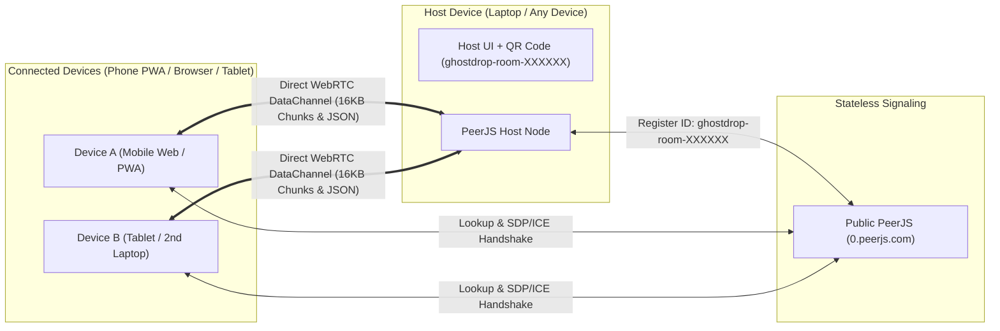

# GhostDrop Phase 1 - Web & PWA Implementation Plan

GhostDrop Phase 1 delivers a zero-cost, 100% stateless, ephemeral P2P device bridge built as an installable Progressive Web App (PWA) with **Vite + React + TypeScript + Tailwind CSS**. Any device (laptop, phone, tablet) can host or join a session via QR code, deep link, or 6-character code, and stream clipboard snippets, links, and files peer-to-peer over WebRTC `RTCDataChannel` using the exact Phase 1/2 shared wire protocol.

---

## 1. Architecture & Multi-Peer Room Design



### Multi-Peer Star-Relay Topology with PeerJS
Because PeerJS assigns one peer ID per connection endpoint:
1. **Room Host (`ghostdrop-room-XXXXXX`)**:
   - Generates a random 6-character unambiguous alphanumeric code (excluding `0/O`, `1/I/L`) and claims the PeerJS ID `ghostdrop-room-XXXXXX`.
   - Listens for incoming `DataConnection` requests from any number of joining devices.
   - Maintains a map of active peer connections (`Map<peerId, PeerSession>`) and optionally relays messages between connected peers so all devices in the room see shared items (or allows targeting a specific device).
2. **Joining Devices (`ghostdrop-peer-<random>`)**:
   - Join via URL (`/?room=XXXXXX` or `/join?room=XXXXXX`), manual 6-char code input, or the built-in **In-App QR Scanner**.
   - Connect directly to `ghostdrop-room-XXXXXX` over WebRTC `RTCDataChannel` (`serialization: 'none'` or raw binary/JSON handling to strictly follow the Section 5 wire protocol).
3. **Signaling Abstraction Layer**:
   - All PeerJS logic lives behind a `P2PTransportAdapter` interface so swapping or adding a `SupabaseRealtimeAdapter` later requires zero UI changes.

---

## 2. Wire Protocol & Backpressure Engine

To guarantee 100% compatibility with the future Phase 2 Android app, the WebRTC transport layer strictly implements the **Section 5 Shared Wire Protocol**:

| Packet Type | Format | Details |
| :--- | :--- | :--- |
| `HELLO_PEER` | JSON `{ type: "HELLO_PEER", id, deviceName, deviceType }` | Sent upon channel open to display friendly device badges (e.g., *"iPhone Safari"*, *"Windows Desktop"*). |
| `CLIPBOARD_TEXT` | JSON `{ type: "TEXT", id, text, timestamp, ttlMs? }` | Instant text/link drop. Auto-detects URLs and renders 1-tap `[Copy]` & `[Open]` actions. |
| `FILE_START` | JSON `{ type: "FILE_START", id, name, size, mime, totalChunks, ttlMs? }` | Initializes an in-memory `Uint8Array[]` chunk buffer and progress tracker on the receiver. |
| `FILE_CHUNK` | Binary `ArrayBuffer` (16,384 bytes max) | Raw binary slice. When multiple files or peers are active, chunks are sequenced per file transfer. |
| `FILE_END` | JSON `{ type: "FILE_END", id }` | Triggers receiver to assemble chunks into a `Blob`, create an object URL, and emit `FILE_ACK`. |
| `FILE_ACK` | JSON `{ type: "FILE_ACK", id, status: "OK" }` | Confirms receipt. Supports "Burn on Send" / "Drop & Nuke" workflows. |

> [!TIP]
> **WebRTC DataChannel Backpressure Control**
> Sending a 50MB file in a tight `while` loop will overflow the browser's SCTP send buffer and crash the `RTCDataChannel`. Our file streamer monitors `dataChannel.bufferedAmount` (configured with `bufferedAmountLowThreshold = 65536` / 64KB) and pauses slicing whenever buffered data exceeds `256KB`, resuming immediately on the `bufferedamountlow` event.

---

## 3. PWA, Web Share Target & Ephemeral Lifecycle Features

### 3.1 Installable PWA + Web Share Target API
- Configured via `vite-plugin-pwa` with a custom service worker (`src/sw.ts`).
- **Manifest `share_target`**: Registers GhostDrop with the OS (Android, ChromeOS, Windows/macOS PWA) to accept shared `text`, `url`, and `files` (`image/*`, `video/*`, `application/*`, `*/*`).
- When a user takes a screenshot on their phone and taps **Share -> GhostDrop**, the Service Worker intercepts the `POST /share-target` request, caches the shared payload in temporary IndexedDB/memory handoff, opens the PWA, and automatically beams it to the active room (or prompts to scan the room QR code if not yet connected).

### 3.2 Built-in In-App QR Scanner
- Allows an installed PWA user to tap **"Scan QR to Connect"** directly inside GhostDrop without switching to their phone's camera app.
- Uses `navigator.mediaDevices.getUserMedia({ video: { facingMode: 'environment' } })` paired with `jsQR` (universal support across iOS Safari, Android Chrome, and Desktop webcams).

### 3.3 Ephemeral Memory & Local TTL Auto-Expiry
- **Item-Level & Room-Level TTL**: Users can set an expiration timer on dropped items (`5m`, `15m`, `50m`, `Never (until tab close)`, or `Burn after 1st download/copy`).
- **Live Countdown Badges**: Each item in the feed displays a live countdown badge (e.g., `⏳ 49:12`) before self-destructing.
- **Zero-Leak Memory Cleanup**:
  - When an item's TTL expires, is manually deleted, or the tab closes (`beforeunload` / `pagehide`), GhostDrop calls `URL.revokeObjectURL(blobUrl)` and zeroes out chunk references so nothing lingers in browser RAM.

---

## 4. Proposed Directory & File Structure

```text
GhostDrop/
├── public/
│   ├── favicon.svg
│   ├── pwa-192x192.png
│   └── pwa-512x512.png
├── src/
│   ├── types/
│   │   └── protocol.ts           # Wire protocol types (TEXT, FILE_START, FILE_END, FILE_ACK, PeerInfo)
│   ├── lib/
│   │   ├── roomCode.ts           # 6-char generator, URL parser, device name detector
│   │   ├── p2p/
│   │   │   ├── adapter.ts        # Signaling/Transport interface (ready for Supabase fallback)
│   │   │   ├── peerjsEngine.ts   # PeerJS multi-peer host/client manager + WebRTC DataChannel
│   │   │   └── fileStreamer.ts   # 16KB ArrayBuffer chunker with bufferedAmountLowThreshold
│   │   └── shareTarget.ts        # Retrieves shared files/text passed via PWA Web Share Target
│   ├── hooks/
│   │   ├── useGhostRoom.ts       # React hook managing room state, peers, transfers, & TTL cleanup
│   │   └── useTtlJanitor.ts      # 1-second interval timer that purges expired items & revokes Blob URLs
│   ├── components/
│   │   ├── Header.tsx            # Brand bar, PWA Install button, TTL default selector, Disconnect
│   │   ├── PairingPanel.tsx      # QR Code card, 6-char room code, copy link, connected devices list
│   │   ├── QrScannerModal.tsx    # In-app camera QR scanner (jsQR + getUserMedia)
│   │   ├── DropZone.tsx          # Drag-and-drop file area + instant Ctrl+V clipboard & text composer
│   │   └── TransferFeed.tsx      # Live stream of text snippets & files with progress bars, TTL timers, Copy/Download
│   ├── sw.ts                     # Service Worker with PWA caching + /share-target POST interceptor
│   ├── App.tsx                   # Main responsive layout (Desktop split-view / Mobile stacked-view)
│   ├── main.tsx
│   └── index.css                 # Tailwind CSS + dark cyberpunk/ghost aesthetic styling
├── index.html
├── vite.config.ts                # Vite + vite-plugin-pwa configuration
├── vercel.json                   # SPA rewrites for /join?room=XXXXXX on Vercel
├── tsconfig.json
└── package.json
```

---

## 5. Step-by-Step Execution Plan

1. **Scaffold & Tooling Setup**:
   - Initialize Vite + React + TypeScript project in `c:\Users\Kingsley\Documents\Web_Project\GhostDrop`.
   - Install dependencies: `peerjs`, `qrcode.react`, `jsqr`, `lucide-react`, ` tailwindcss`, `@tailwindcss/vite`, `vite-plugin-pwa`.
2. **Core Protocol & 16KB Streaming Engine (`src/lib/p2p/`)**:
   - Implement `protocol.ts`, `roomCode.ts`, `fileStreamer.ts` (16,384-byte chunks + backpressure), and `peerjsEngine.ts` (supporting Host room creation, Client room joining, multi-peer broadcasting, and automatic reconnect/error handling).
3. **Ephemeral State & TTL Janitor (`src/hooks/`)**:
   - Build `useGhostRoom.ts` and `useTtlJanitor.ts` to manage received/sent items, live transfer progress percentages, `URL.revokeObjectURL` cleanup on TTL expiry, and `window` paste (`Ctrl+V`) listeners.
4. **UI & Responsive Experience (`src/components/`)**:
   - Craft a sleek, dark-mode-first "Ghost" UI with instant visual feedback:
     - **Pairing Panel**: Scannable QR code (`qrcode.react`), 1-click room code copy, "Join another room" input, and "Scan QR" camera modal.
     - **Drop & Paste Hub**: Global `Ctrl+V` listener (paste text or screenshots anywhere on the page to send immediately), multi-file drag-and-drop zone, and quick text/link box.
     - **Ephemeral Feed**: Real-time progress bars for 16KB chunk streams, image previews for dropped screenshots, clickable links, 1-tap `[Copy]` / `[Download]`, and customizable TTL self-destruct timers (`15m`, `50m`, `24h`, `Burn on Copy`).
5. **PWA & Web Share Target Integration**:
   - Configure `vite-plugin-pwa` with `injectManifest` and `src/sw.ts` to handle `/share-target` POST requests and offline app shell loading, plus `vercel.json` for clean routing.
6. **Verification & End-to-End Testing**:
   - Run TypeScript typechecking and production build (`npm run build`).
   - Verify local two-tab/multi-device WebRTC connection, text sync, 16KB chunked file transfer with progress & `FILE_ACK`, and TTL auto-expiration.
